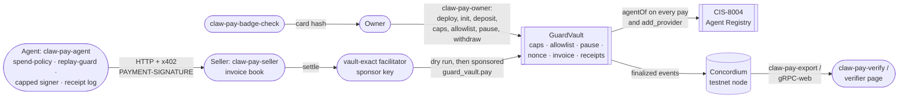
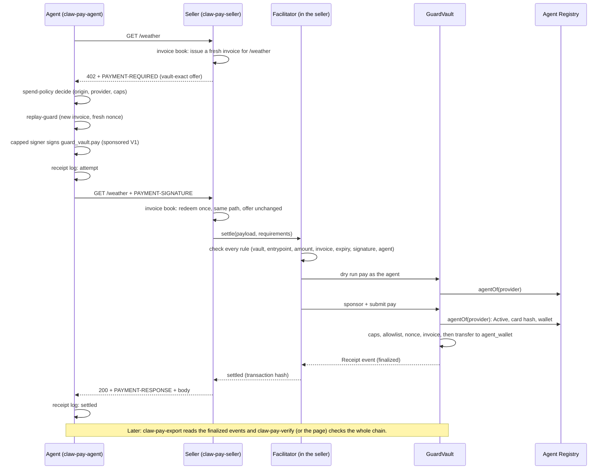

# Architecture

Claw Pay for Concordium lets an AI agent pay on Concordium testnet with three properties:
- it pays only within limits it can't change,
- it pays only providers verified in the Agent Registry,
- every payment leaves a public receipt that anyone can check.

This page shows how the pieces fit. `THREAT_MODEL.md` says why each piece is there, and what it protects against.

## The pieces

| Piece | Where | What it does |
|---|---|---|
| `GuardVault` | `contracts/guard-vault/` | The Rust smart contract that holds the test CCD. It enforces per-payment and daily caps, the provider allowlist, a pause, replay protection, and a registry check on every payment, and it logs a hash-linked `Receipt` for every payment. The owner manages the rules; the agent can only call `pay`. |
| Mock registry | `contracts/mock-agent-registry/` | A **test-only** CIS-8004 Agent Registry used by the contract tests. It is never deployed. |
| Verifier | `packages/verifier/` | `claw-pay-verify`. It rebuilds the receipt chain from the vault's events alone: every hash, every link, a replay of the owner's rules, and the head check. |
| Badge check | `packages/badge-check/` | `claw-pay-badge-check`. It confirms a registry agent is "Verified by Concordium": Active, with a card whose SHA-256 equals the on-chain `metadata_hash`. It runs before the owner allowlists the agent. |
| x402 scheme | `packages/x402-vault/` | The `vault-exact` x402 scheme (spec in [`x402-vault-scheme.md`](x402-vault-scheme.md)): the agent's client side, and the facilitator that checks, dry-runs, sponsors and confirms payments. |
| Agent client | `packages/agent-client/` | `payFetch`. It pays a 402 through the vault only if spend-policy, replay-guard and the capped signer all agree, and keeps a hash-linked local receipt log. |
| Node adapter | `packages/node-adapter/` | The live testnet connection: the genesis guard, the vault view, the gRPC chains for the facilitator and the client, `claw-pay-export`, and reconciling the local log against the chain. |
| Owner CLI | `packages/owner-cli/` | `claw-pay-owner`: deploy, init, deposit, caps, agent, pause, allowlist, withdraw and view. It is a dry run unless `--send` is given. |
| Demo | `packages/demo/` | `claw-pay-seller` (an x402 seller with an invoice book and an in-process facilitator) and `claw-pay-agent`. |
| Verifier page | `packages/verifier-page/` | The verifier's checks in a browser, on an events file or read live from a testnet node. |

## Who talks to whom

## One paid request

## Where each rule is enforced

The contract is the source of truth. Everything above it is a second layer, so a bug or a compromise there still leaves the vault's limits in place.

| Rule | Enforced by |
|---|---|
| Per-payment cap, daily cap (fixed UTC day), pause | `GuardVault`. The agent's spend-policy and capped signer apply the agent's own tighter caps first. |
| Only allowlisted, Active, registry-verified providers, paid at their `agent_wallet` | `GuardVault` (registry checked on every `pay`). `claw-pay-badge-check` runs before allowlisting. |
| Each nonce and each invoice hash only once | `GuardVault`. The agent's replay-guard and the seller's invoice book refuse reuse earlier. |
| Only the agent may pay; only the owner changes rules or withdraws | `GuardVault` |
| The agent key signs nothing but a capped `pay` on its own vault | The capped signer (agent client) |
| The agent pays only the provider it expects for the origin it called | Spend-policy (agent client) |
| A payment is used only for the resource it was bought for | The seller's invoice book |
| The sponsor pays fees only for valid, dry-run-tested `pay` calls on configured vaults | The facilitator (decision 8) |
| Testnet only | Every tool checks `CLAW_PAY_NETWORK=testnet` first. The node guard checks the genesis hash. Key files must be testnet exports. |
| Every receipt is genuine and complete | `claw-pay-verify` and the verifier page: hashes, links, rule replay and the head check. |

## Data formats

Each format is pinned by a fixture that the contract tests write and the TypeScript tests read, so the two sides can't drift apart.

| Format | Layout | Fixture |
|---|---|---|
| `pay` parameter | `provider u64 · amount u64 · nonce u64 · invoice_hash [32]`, little-endian, 56 bytes | `fixtures/pay-params.v1.json` |
| Owner parameters | `InitParams` (64 bytes), `CapsParams` (16), account (32), bool (1), `ProviderParams` (40), u64 (8). Also the vault's reject codes, `-1` to `-20`. | `fixtures/owner-params.v1.json` |
| Receipt | Body of 208 bytes: vault, nonce, `prev_hash`, timestamp, agent, provider, card hash, payee, amount, invoice hash. The event is `8 · body · sha256(body)`, 241 bytes. Each `prev_hash` is the previous receipt's hash. | `fixtures/vault-events.v1.json` |
| `view` | Owner, agent, registry, caps, paused, `next_nonce`, `current_day`, `spent_today`, balance, receipt head. 161 bytes. | `fixtures/vault-view.v1.json` |
| Registry reply | CIS-8004 `agentOf` | `fixtures/agent-views.v1.json` |
| Events file | `claw-pay-concordium/vault-events/v1`: the vault, `view { next_nonce, receipt_head }`, and the raw events in chain order | `fixtures/vault-events.v1.json` |

## How it is tested

- **Contract:** 61 Rust tests on the simulated chain, one per invariant (INV-1 to INV-11), plus the golden fixtures above.
- **TypeScript:** more than 240 tests across eight packages, all offline:
  - the facilitator and the client run against in-memory chains,
  - the live adapter runs against a fake node that returns the SDK's own shapes,
  - the demo rehearsal runs the real agent against the real seller on one in-memory testnet,
  - no test opens a network connection beyond 127.0.0.1.
- **Mutation checks:** in every pull request, key safety checks were removed one at a time to confirm the tests fail. Several weak tests were found and tightened this way; the pull requests describe each one.
- **CI:** fmt, clippy, the contract builds and tests; lint, typecheck and tests; a rebuild of the verifier page compared with the committed copy; and gitleaks over the full history.
